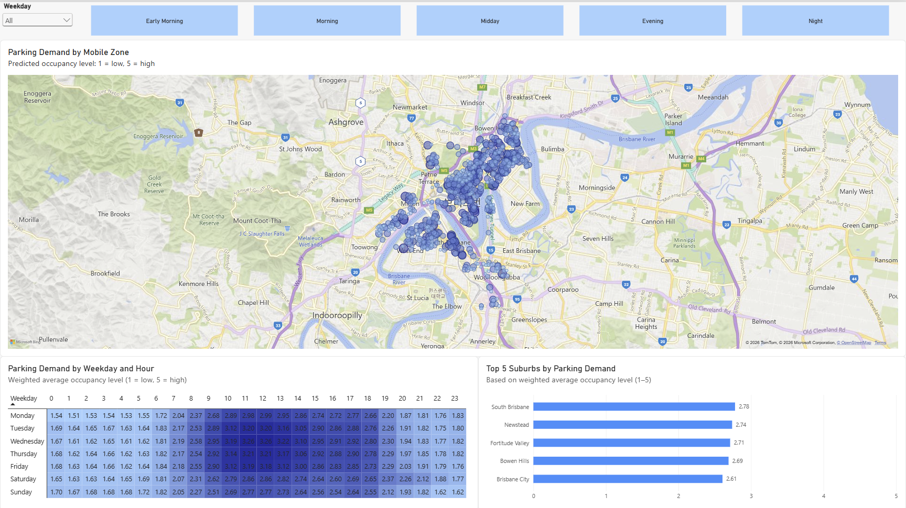
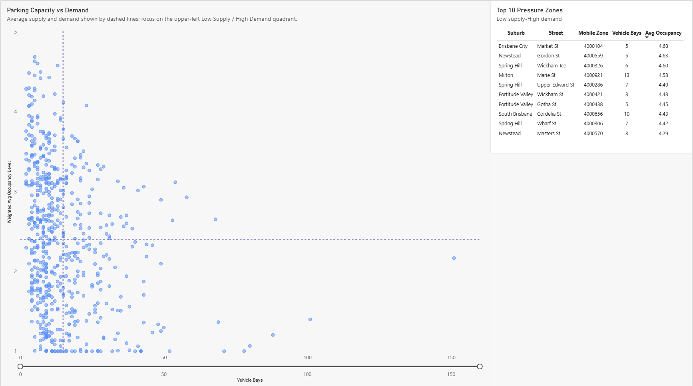
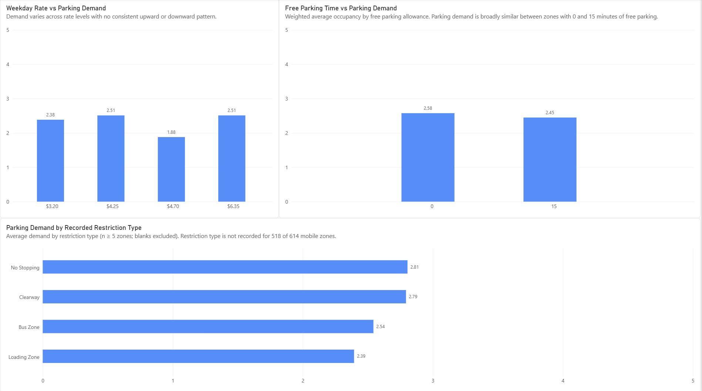

# Brisbane Parking Demand Analysis

An end-to-end data analytics project exploring **when and where Brisbane's metered parking experiences the greatest predicted demand**, and how that demand relates to **parking capacity, pricing and parking conditions**.

**Tools:** Excel · Python · pandas · Power BI · Power Query · DAX

---

## Project at a Glance

| Metric | Result |
|---|---:|
| Raw occupancy forecast records | 2,425,123 |
| Aggregated forecast rows | 94,647 |
| Forecast Mobile Zones | 610 |
| Parking meter records | 944 |
| Meter Mobile Zones | 614 |
| Mobile Zones matched across both datasets | 609 |
| Total vehicle bays | 9,136 |
| Total motorcycle bays | 256 |
| Overall weighted predicted occupancy | 2.46 / 5 |

---

## Dashboard Preview



---

## Business Question

> **When and where is Brisbane's metered parking under the greatest demand, and how does that demand relate to parking capacity, pricing and restrictions?**

The analysis focuses on three areas:

1. **Demand patterns**  
   Where and when is predicted parking demand highest?

2. **Capacity pressure**  
   Which Mobile Zones combine relatively low parking supply with high predicted demand?

3. **Pricing and parking conditions**  
   How does predicted demand vary across parking rates, free-parking allowances and recorded restriction types?

---

## Key Findings

- Overall weighted predicted occupancy was approximately **2.46 on the 1–5 scale**.

- **South Brisbane** recorded the highest suburb-level weighted demand at approximately **2.78**, followed by Newstead and Fortitude Valley.

- Demand generally increased through the morning and was strongest around **late morning to midday**.  
  The highest Weekday × Hour combination was **Wednesday, 12:00–12:59**, with a weighted predicted occupancy of approximately **3.26**.

- Several relatively low-capacity Mobile Zones recorded high predicted demand, including:
  - **Market St, Brisbane City** — 5 vehicle bays, average occupancy **4.68**
  - **Gordon St, Newstead** — 5 vehicle bays, average occupancy **4.63**
  - **Wickham Terrace, Spring Hill** — 6 vehicle bays, average occupancy **4.60**

- Weekday parking rates showed **no consistent upward or downward relationship** with predicted demand.

- Demand was broadly similar between free-parking groups:
  - **0 minutes:** 2.58 average occupancy across 66 Mobile Zones
  - **15 minutes:** 2.45 average occupancy across 548 Mobile Zones

- Restriction Type was not recorded for **518 of 614 Mobile Zones**.  
  Restriction comparisons were therefore limited to recorded categories represented by at least five Mobile Zones.

These findings describe patterns and associations in the dataset and are **not interpreted as causal relationships**.

---

## Data Sources

Data was sourced from **Brisbane City Council Open Data**.

### Parking — Meter Locations

[Brisbane Parking Meters — Brisbane City Council Open Data](https://data.brisbane.qld.gov.au/explore/dataset/brisbane-parking-meters/information/?disjunctive.suburb&disjunctive.max_stay_hrs&disjunctive.tar_zone)

The dataset contains information including:

- Mobile Zone
- street and suburb
- vehicle and motorcycle bays
- parking rates
- free parking minutes
- maximum stay
- restrictions
- operating hours
- latitude and longitude

### Parking — Occupancy Forecasting

[Parking Occupancy Forecasting — Brisbane City Council Open Data](https://data.brisbane.qld.gov.au/explore/dataset/parking-occupancy-forecasting/information/)

The dataset contains:

- Mobile Zone
- Date
- Hour
- Predicted occupancy level (`OCCUPANCY_PRED`)

`OCCUPANCY_PRED` is an ordinal predicted occupancy level:

- **1 = low occupancy**
- **5 = high occupancy**
- **0 = occupancy information unavailable**

A value of `0` was therefore treated as **unavailable**, not as zero parking demand.

The datasets are linked using **Mobile Zone**.

---

## Data Preparation

### 1. Parking Meter Data — Excel Cleaning

The original Brisbane parking meter dataset was manually reviewed and cleaned in **Excel** before Python aggregation.

This was a deliberate preprocessing step rather than an automated Python transformation.

The cleaned intermediate file used for the subsequent analysis is retained in:

`data/interim/Cleaned_brisbane-parking-meters.xlsx`

This provides the exact input used by the Mobile Zone aggregation notebook.

---

### 2. Occupancy Forecasting — Python Aggregation

The original occupancy forecasting dataset contains **2,425,123 records**.

Because of its size, the dataset was processed using **pandas in 20,000-row chunks** rather than loading the complete file into memory at once.

Key transformations included:

- converting `DATE` to datetime
- deriving weekday from each date
- treating `OCCUPANCY_PRED = 0` as unavailable
- retaining valid occupancy levels from 1 to 5
- aggregating observations to:

**Mobile Zone × Weekday × Hour**

For each group, the following were retained:

- `Occupancy_Sum`
- `Occupancy_Count`
- `Avg_Occupancy_Level`

The final forecasting fact table contains:

**94,647 rows across 610 Mobile Zones**

Notebook:

[`01_occupancy_forecast_aggregation.ipynb`](notebooks/01_occupancy_forecast_aggregation.ipynb)

---

### 3. Parking Meter — Mobile Zone Aggregation

The cleaned meter dataset contained **944 individual meter records**.

These were aggregated in Python to create a dimension table with:

**614 unique Mobile Zones**

The aggregation preserved relevant attributes including:

- meter count
- vehicle and motorcycle capacity
- street
- suburb
- parking system
- pricing
- free parking allowance
- restrictions
- operating conditions
- geographic coordinates

For Mobile Zones spanning multiple suburbs:

- all suburb values were retained in `Suburb_All`
- the suburb containing the greater number of vehicle bays was assigned as `Primary_Suburb`

The final dataset contains exactly **one row per Mobile Zone**.

Notebook:

[`02_parking_meter_mobile_zone_aggregation.ipynb`](notebooks/02_parking_meter_mobile_zone_aggregation.ipynb)

---

## Data Model

The Power BI model separates the parking demand observations from the Mobile Zone attributes.

```text
Parking Meter
614 Mobile Zones
(one row per Mobile Zone)
        1
        │
        │  Mobile Zone
        │
        *
Parking Forecast
94,647 rows
(Mobile Zone × Weekday × Hour)
```

Relationship:

```text
Parking Meter[Mobile Zone]  1 ───── *  Parking Forecast[Mobile Zone]
```

Filter direction:

```text
Parking Meter → Parking Forecast
```

This prevents parking capacity and pricing attributes from being duplicated across hourly forecast records.

### Dataset Matching

- Forecast Mobile Zones: **610**
- Meter Mobile Zones: **614**
- Present in both datasets: **609**
- Meter-only zones: **5**
- Forecast-only zones: **1**

---

## Key DAX Logic

### Weighted Average Occupancy

A weighted measure was used instead of averaging pre-calculated row averages:

```DAX
Weighted Avg Occupancy Level =
DIVIDE(
    SUM('Parking Forecast'[Occupancy Sum]),
    SUM('Parking Forecast'[Occupancy Count])
)
```

This ensures groups with different numbers of valid observations contribute correctly to the final result.

### Capacity Pressure

Potential pressure zones were defined as Mobile Zones with:

- parking supply **below the current average**, and
- predicted parking demand **above the current average**

These zones were then ranked by weighted predicted occupancy to identify the **Top 10 Pressure Zones**.

This is used as an analytical prioritisation rule rather than a claim that the zones are definitively undersupplied.

---

## Dashboard

### 1. Parking Demand Overview

The first page focuses on **where and when demand is highest**.

It includes:

- predicted demand by Mobile Zone
- Top 5 suburbs by weighted demand
- Weekday × Hour heatmap
- Weekday filtering
- Time of Day filtering
- custom Mobile Zone tooltip

The heatmap retains the full 24-hour context while other visuals can be explored using Time of Day filters.

---

### 2. Capacity & Pressure



This page examines the relationship between **parking capacity and predicted demand**.

It includes:

- Mobile Zone-level capacity vs demand scatter plot
- average parking supply reference line
- average parking demand reference line
- Top 10 low-supply / high-demand pressure zones

The analysis highlights potential areas for further investigation rather than asserting that parking capacity directly causes demand.

---

### 3. Pricing & Parking Conditions



This page explores variation in demand across:

- weekday parking rates
- free-parking allowances
- recorded restriction types

Restriction categories are shown only where:

```text
Mobile Zone Count ≥ 5
```

Unrecorded Restriction Type values are excluded from this comparison.

---

## Reproducing the Analysis

### Occupancy Forecast

1. Download the original Parking Occupancy Forecasting dataset from Brisbane City Council Open Data.
2. Save it as:

```text
parking_occupancy_forecasting.csv
```

3. Run:

```text
notebooks/01_occupancy_forecast_aggregation.ipynb
```

4. The notebook produces:

```text
data/processed/parking_forecast_aggregated.csv
```

### Parking Meter Data

The meter dataset contains a manual Excel cleaning stage.

To reproduce the exact downstream analysis, use the included cleaned intermediate file:

```text
data/interim/Cleaned_brisbane-parking-meters.xlsx
```

Then run:

```text
notebooks/02_parking_meter_mobile_zone_aggregation.ipynb
```

This produces:

```text
data/processed/parking_meter_by_mobile_zone.csv
```

### Power BI

Load the two processed datasets into Power BI and open:

[`Brisbane_Parking_Demand_Analysis.pbix`](dashboard/Brisbane_Parking_Demand_Analysis.pbix)

---

## Limitations

- `OCCUPANCY_PRED` represents a **predicted occupancy level from 1 to 5**, not an occupancy percentage or number of parked vehicles.

- `OCCUPANCY_PRED = 0` indicates unavailable information and is excluded from demand calculations.

- Individual dates were removed during aggregation. The dashboard therefore analyses **typical weekday/hour patterns**, not historical trends or seasonality.

- Pricing, capacity and parking-condition comparisons are observational. They show **associations rather than causal effects**.

- Restriction Type is missing for **518 of 614 Mobile Zones**, substantially limiting restriction-based analysis.

- Free Parking Minutes is highly imbalanced: 548 zones have 15 free minutes while 66 have 0 minutes.

- Six Mobile Zones are unmatched across the two datasets: five exist only in the meter data and one only in the forecast data.

- The initial parking meter cleaning stage was performed manually in Excel. The exact cleaned intermediate file is included for transparency and downstream reproducibility.

---

## Repository Structure

```text
brisbane-parking-demand-analysis/
│
├── dashboard/
│   └── Brisbane_Parking_Demand_Analysis.pbix
│
├── notebooks/
│   ├── 01_occupancy_forecast_aggregation.ipynb
│   └── 02_parking_meter_mobile_zone_aggregation.ipynb
│
├── data/
│   ├── raw/
│   │   ├── brisbane-parking-meters.csv
│   │   └── Parking_Occupancy forecasting_metadata.csv
│   │
│   ├── interim/
│   │   └── Cleaned_brisbane-parking-meters.xlsx
│   │
│   └── processed/
│       ├── parking_forecast_aggregated.csv
│       └── parking_meter_by_mobile_zone.csv
│
└── images/
    ├── 01_parking_demand_overview.png
    ├── 02_capacity_pressure.png
    └── 03_pricing_parking_conditions.png
```

---

## Workflow

```text
Parking Occupancy Forecasting
          │
          ▼
Python / pandas
20,000-row chunk processing
          │
          ▼
Mobile Zone × Weekday × Hour
aggregation
          │
          ▼
parking_forecast_aggregated.csv
          │
          │
          ├───────────────┐
          │               │
          │               ▼
          │          Power BI Model
          │               │
          │          Power Query
          │               │
          │              DAX
          │               │
          │               ▼
          │      Interactive Dashboard
          │
          │
Brisbane Parking Meters
          │
          ▼
Manual Excel Cleaning
          │
          ▼
Python Mobile Zone Aggregation
          │
          ▼
parking_meter_by_mobile_zone.csv
```

---

## Skills Demonstrated

- Excel data cleaning
- Python
- pandas
- large-file chunk processing
- data cleaning and validation
- data aggregation
- relational data modelling
- Power Query
- DAX
- weighted measures
- Power BI dashboard development
- data visualisation
- data quality assessment
- analytical interpretation

---

## Project Files

### Power BI

[`Brisbane_Parking_Demand_Analysis.pbix`](dashboard/Brisbane_Parking_Demand_Analysis.pbix)

### Python Notebooks

- [`01_occupancy_forecast_aggregation.ipynb`](notebooks/01_occupancy_forecast_aggregation.ipynb)
- [`02_parking_meter_mobile_zone_aggregation.ipynb`](notebooks/02_parking_meter_mobile_zone_aggregation.ipynb)

---

## Data Availability

The full raw Parking Occupancy Forecasting CSV is **not stored in this repository**.

The original file contains more than 2.4 million records and is publicly available from Brisbane City Council Open Data.

Keeping the source file outside the repository avoids duplicating a large publicly hosted dataset while keeping all processing logic available in the notebook.

The processed forecasting dataset used by Power BI is included in:

```text
data/processed/parking_forecast_aggregated.csv
```

---

## Data Attribution

Data provided by **Brisbane City Council Open Data**.

- [Parking — Meter Locations](https://data.brisbane.qld.gov.au/explore/dataset/brisbane-parking-meters/information/?disjunctive.suburb&disjunctive.max_stay_hrs&disjunctive.tar_zone)
- [Parking — Occupancy Forecasting](https://data.brisbane.qld.gov.au/explore/dataset/parking-occupancy-forecasting/information/)

**Licence:** Creative Commons Attribution 4.0 International (CC BY 4.0)

---

## Author

**Sienna Lee**

Data Analyst  
Power BI · SQL · Excel · Python
